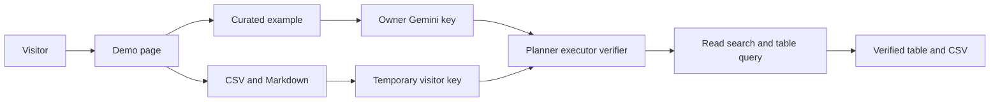

# AI Data Analyst Agent

Ask an analytical question over CSV and Markdown files and receive a verified table. The agent plans an approach, reads relevant files, runs constrained table queries, and returns a downloadable CSV.

It began as a KDD Cup 2026 data agent. The competition explains the batch layout, Docker packaging, and scoring rule that penalizes extra answer columns. The portfolio demo turns that loop into a practical folder-in, table-out analyst without claiming production users or an official rank.

## Public-safe demo

```powershell
pip install -e ".[dev]"
Copy-Item .env.example .env
# Optional: put an owner Gemini key in .env for the live curated example.
python serve.py
```

Open http://127.0.0.1:8765.

The page has two modes:

- **Try example:** `knowledge.md` defines net revenue and `orders.csv` holds the data. A cached result is always visible; `Run live` uses the deployment owner's capped Gemini key.
- **Use your files:** upload or paste up to 3 CSV files plus 1 Markdown file, choose Gemini or OpenAI, and provide your own key for that run.

A visitor key is sent over the same HTTPS connection as the files, held only by the running server thread, never written to `.env`, disk, logs, cookies, local storage, or a response, and discarded when the job ends. Do not deploy this page without HTTPS.

The application chooses the model. Gemini uses `gemini-3.5-flash-lite` with request pacing. OpenAI selects the first available cost-conscious model from `gpt-5-mini`, `gpt-4.1-mini`, and `gpt-4o-mini`. No provider key is unlimited: billing, token, per-minute, and daily limits still apply.

## Public safety boundary

Uploaded files are temporary and deleted after the run. The public agent can only:

- list files;
- read CSV and Markdown;
- search Markdown;
- query uploaded CSVs through isolated in-memory SQLite using one read-only `SELECT` or `WITH` statement; and
- submit the answer table.

Generated Python, arbitrary database paths, images, PDFs, and the broader competition toolset are disabled for public uploads. The local `ask.py` and competition `main.py` retain the full toolset. Uploaded file text is explicitly marked as untrusted data in the public prompt.

Limits are intentionally small: 500 KB per file, 1.5 MB total, 3 CSV files, 1 Markdown file, 2,000 question characters, finite agent steps, and a 180-second public timeout. Example runs have a daily cap and per-IP cooldown. BYOK runs have bounded concurrency.

## Architecture



1. The planner sees the question and file tree and returns a short JSON plan.
2. The executor calls one allowed tool per step. Observations are truncated and old turns are trimmed.
3. The verifier removes columns the question did not request.

The browser displays only high-level tool progress, not chain-of-thought, raw prompts, secrets, or stack traces.

## Deployment

Deploy the demo on [Render](https://render.com) free web service. Vercel and other serverless hosts end the process when the HTTP response returns, which stops the agent before it can finish. This server answers `POST /api/upload` immediately and keeps working in a background thread, so the process has to stay running. Render provides the HTTPS certificate.

From the repository root, Render can create the service from `render.yaml`:

1. Push this repository to GitHub.
2. In the Render dashboard, choose **New** → **Blueprint** and select the repository.
3. When Render asks for `MODEL_API_KEY`, paste the owner Gemini key. Leave it blank to publish the cached example only. Visitor uploads still use the key the visitor pastes.
4. Open the `*.onrender.com` URL Render assigns.

The free instance sleeps after 15 minutes without a request and takes about a minute to wake. Polling during a run counts as traffic, so it stays awake until that run finishes. Uploaded files live on the instance disk and are deleted after the job. A restart clears the in-memory job list and the owner daily counter.

`render.yaml` sets `HOST=0.0.0.0` and leaves `PORT` to Render. Local `python serve.py` still binds `127.0.0.1:8765`.

The Docker image defaults to the competition batch runner. For a portfolio host, override the command with:

```text
python serve.py
```

Set these environment variables on any Docker-compatible HTTPS host:

```text
HOST=0.0.0.0
PORT=<platform-provided port>
MODEL_API_KEY=<owner Gemini key; optional if cached-only example is acceptable>
MODEL_PROVIDER=gemini
MODEL_API_URL=https://generativelanguage.googleapis.com/v1beta/openai/
MODEL_NAME=gemini-3.5-flash-lite
MODEL_REASONING_EFFORT=minimal
MODEL_MIN_INTERVAL_SECONDS=7
PUBLIC_TASK_TIMEOUT_SECONDS=180
OWNER_DAILY_LIMIT=20
OWNER_COOLDOWN_SECONDS=60
BYOK_CONCURRENCY=2
```

The counters and completed-job cache are in process memory. They reset when the container restarts; that is appropriate for this small portfolio demo, not a multi-instance product.

## Local full-agent usage

To analyze a trusted local folder with all tools, including Python, Excel, SQLite, PDF and images:

```powershell
python ask.py --context examples/benchmark/csv_totals/context --question "What is the total amount for each region? Include only the region and its total amount." --output output/ask/prediction.csv
```

`main.py` is the KDD batch runner. It reads tasks under `INPUT_ROOT` and writes `output/<task_id>/prediction.csv`.

## Evaluation and tests

Four gold-labelled tasks live in `examples/benchmark`: CSV aggregation, SQLite join, Markdown-defined revenue, and a two-sheet Excel calculation.

```powershell
pytest
$env:PYTHONPATH = "src"
python -m agent.eval --benchmark examples/benchmark --predictions output
```

The score is recall minus `lambda * extra_columns / predicted_columns`. Headers and row order do not matter; numbers match after rounding to two decimals. The report is a local benchmark, not an official leaderboard result.

## Resume wording

- Built and deployed a planner-executor-verifier data agent that converts natural-language questions over business files into verified tables through a policy-controlled tool loop.
- Added per-run Gemini/OpenAI configuration, temporary upload isolation, read-only in-memory SQL, capability allowlists, quota controls, tests, and Docker packaging for a public portfolio demo.
