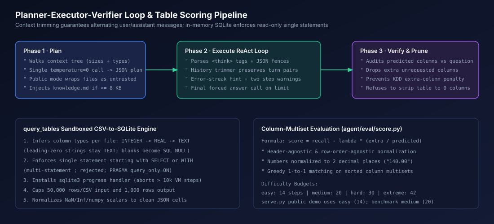

# Architecture & System Design

**Stet** converts a directory of heterogeneous business artifacts into a verified tabular result (`prediction.csv`) through a three-phase **Planner → Executor → Verifier** loop with strict trust boundaries between its public web server and local KDD batch mode.




---

## 1. Execution Surfaces & Dual Trust Model

| Mode | Entrypoint | Allowed Tools | Isolation & Quotas |
| --- | --- | --- | --- |
| **Public Web Demo** | `serve.py` (`ThreadingHTTPServer :8765`, `DataAgent.for_public_upload`) | `list_context`, `read_csv`, `read_doc`, `search_doc`, `query_tables`, `answer` | Temp dir wiped on completion, 500 KB/file, 1.5 MB total, max 3 CSV + 1 MD, 180s timeout, BYOK key discarded from thread memory (`ModelConfig("discarded", ...)`); owner example gated by per-IP cooldown (`60s`) + daily cap (`20`) |
| **Local Trusted CLI** | `ask.py` | Full KDD toolset (+ `run_python`, `read_excel`, `read_pdf`, `grep_context`, `inspect_db`, `execute_sql`, `analyze_image`) | Operates on local `--context` path with 900s timeout (`TASK_TIMEOUT_SECONDS`) |
| **KDD Batch Runner** | `main.py` | Full KDD toolset | `ThreadPoolExecutor(max_workers=2)` over `INPUT_ROOT`, writes `output/<task_id>/prediction.csv` + `/logs/summary.json` |

> **Configuration Note:** `examples/benchmark/knowledge_revenue/task.json` sets `"difficulty": "medium"` (20 max steps), while `serve.py` intentionally runs uploaded & curated demo jobs with `difficulty="easy"` (`max_steps=14`, `max_tokens=2048`) to bound public runtime latency and token spend.

---

## 2. Three-Phase Agent Loop (`src/agent/agents/agent.py`)

1. **Plan (`_plan`):** Walks the context tree with byte sizes and prompts the planner model (`temperature=0.0`) for a structured JSON execution plan.
2. **Execute (`_execute`):** Runs a bounded ReAct loop with:
   - Automatic `knowledge.md` preloading (when `<= 8 KB`) so business-term definitions are immediately in context.
   - Untrusted-data warning block injected whenever `untrusted_context=True`.
   - `_trim_history` + `_ensure_alternating` so trimming long traces preserves the opening user turn, inserts a synthetic assistant trim notice, and guarantees strict `user`/`assistant` alternation required by OpenAI-compatible APIs.
   - Resilient JSON extraction (`_strip_thinking` strips `<think>`, `<|thinking|>`, `<reasoning>`; `_repair_json` strips trailing commas; depth scan handles nested JSON outside fences).
   - Error-streak hints after 3 failures, two-stage step-limit warnings, and a forced `answer` turn on step exhaustion.
3. **Verify (`_verify`):** Audits generated columns against the user question and prunes unrequested columns while ensuring at least one column always remains.

---

## 3. Sandboxed In-Memory CSV-to-SQL Engine (`tool_query_tables`)

Because public uploads disable Python execution (`run_python`), `tool_query_tables` ingests uploaded CSV files into an ephemeral `:memory:` SQLite connection per query:
- Infers column types (`INTEGER` → `REAL` → `TEXT`), leaving blank strings as SQL `NULL` and preserving leading-zero identifiers as `TEXT`.
- Switches SQLite to `PRAGMA query_only = ON`, rejects anything outside single `SELECT` / `WITH` statements, caps row counts (`50,000` input rows/file, `1,000` returned rows), and aborts runaway joins via a `10,000`-iteration `set_progress_handler` interrupt.

---

## 4. Benchmark Evaluation (`src/agent/eval/score.py`)

Four gold-labelled local fixtures validate core modalities under `examples/benchmark/`:
1. `csv_totals` (CSV aggregation)
2. `sqlite_customers` (SQLite relational join)
3. `knowledge_revenue` (Markdown-defined revenue formula over CSV)
4. `excel_revenue` (two-sheet Excel calculation)

Scoring avoids brittle header formatting differences while penalizing bloated outputs:

```
score = recall - lambda * (extra_columns / predicted_columns)
```

Each column is turned into a sorted multiset of normalized values (numbers rounded to 2 decimal places) and matched 1-to-1 against gold columns.
